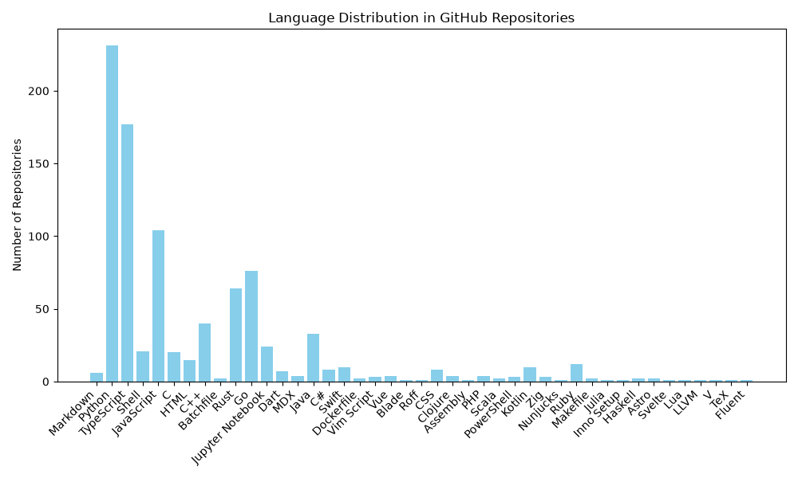

# Language Distribution

Total repositories processed: 915

Language distribution:
Markdown: 6, Python: 231, TypeScript: 177, Shell: 21, JavaScript: 104, C: 20, HTML: 15, C++: 40, Batchfile: 2, Rust: 64, Go: 76, Jupyter Notebook: 24, Dart: 7, MDX: 4, Java: 33, C#: 8, Swift: 10, Dockerfile: 2, Vim Script: 3, Vue: 4, Blade: 1, Roff: 1, CSS: 8, Clojure: 4, Assembly: 1, PHP: 4, Scala: 2, PowerShell: 3, Kotlin: 10, Zig: 3, Nunjucks: 1, Ruby: 12, Makefile: 2, Julia: 1, Inno Setup: 1, Haskell: 2, Astro: 2, Svelte: 1, Lua: 1, LLVM: 1, V: 1, TeX: 1, Fluent: 1

_Last updated: 2026-10-25 02:51:48_
