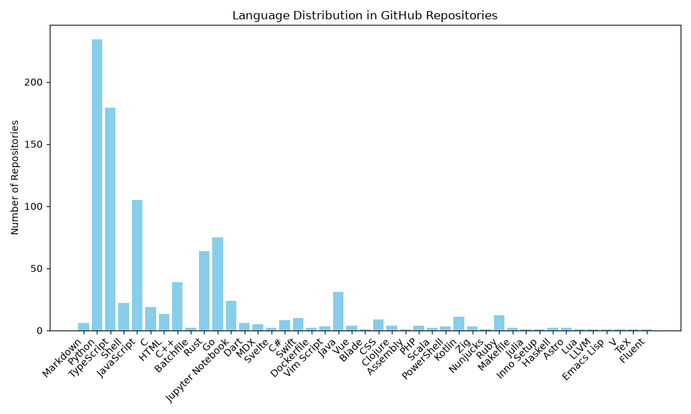

# Language Distribution

Total repositories processed: 918

Language distribution:
Markdown: 6, Python: 234, TypeScript: 179, Shell: 22, JavaScript: 105, C: 19, HTML: 13, C++: 39, Batchfile: 2, Rust: 64, Go: 75, Jupyter Notebook: 24, Dart: 6, MDX: 5, Svelte: 2, C#: 8, Swift: 10, Dockerfile: 2, Vim Script: 3, Java: 31, Vue: 4, Blade: 1, CSS: 9, Clojure: 4, Assembly: 1, PHP: 4, Scala: 2, PowerShell: 3, Kotlin: 11, Zig: 3, Nunjucks: 1, Ruby: 12, Makefile: 2, Julia: 1, Inno Setup: 1, Haskell: 2, Astro: 2, Lua: 1, LLVM: 1, Emacs Lisp: 1, V: 1, TeX: 1, Fluent: 1

_Last updated: 2026-11-08 03:58:33_
